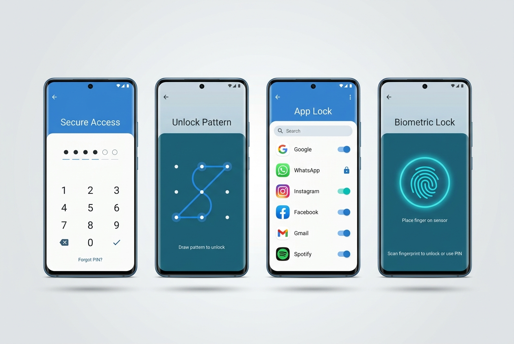

<div align="center">


# 🔐 AppLock Guard (AAB & APK)

### Secure Your Apps. Protect Your Privacy. Android App Bundle (.aab) Ready.

[](https://developer.android.com)
[](https://developer.android.com/guide/app-bundle)
[](https://kotlinlang.org)
[](https://developer.android.com/jetpack/compose)
[](https://android-arsenal.com/api?level=26)
[](LICENSE)

**A high-performance Android App Lock application built with Kotlin & Jetpack Compose.**  
**Features real-time 0ms app locking, Fingerprint / PIN / Pattern security, and a private Gallery Vault.**

[📦 Download AAB / APK](#-download-releases) · [🖼️ App Screens & Image Descriptions](#-app-screens--image-descriptions) · [🔒 Features](#-key-features) · [🛠️ Build Guide](#-build-instructions)

---



</div>

---

## 🖼️ App Screens & Image Descriptions

Below is a detailed walkthrough of each application screen and interface:

### 1. 🛡️ Real-Time "Verify Your Identity" Lock Screen (Image Description)
* **Visual Appearance**: Sleek midnight obsidian theme with an illuminated electric cyan padlock icon, pulsing fingerprint biometric scanner sensor, and dynamic PIN/Pattern dialer pad.
* **Functionality**:
  * Displays "Verify Your Identity" with subtitle *"Use fingerprint or password to continue"*.
  * Triggers biometric sensor vibration immediately upon opening any protected app.
  * Allows smooth fallback to PIN entry or Pattern swipe gesture.
  * Automatically applies a 30-second cooldown timer after 5 incorrect authentication attempts.

### 2. 📱 Modern App Management Dashboard (Image Description)
* **Visual Appearance**: Clean gradient card layout matching the reference UI with dual segmented pill buttons: `[ UNLOCKED (Count) ]` | `[ LOCKED (Count) ]`.
* **Functionality**:
  * Lists all user-installed applications (WhatsApp, Instagram, Photos, YouTube, Settings, etc.) with real-time app icons.
  * Features a **"Lock All"** / **"Unlock All"** one-touch toggle button.
  * Dedicated search bar for instant app filtering.
  * Clickable padlock status button next to each app item.

### 3. 🖼️ Gallery & Media Vault (Image Description)
* **Visual Appearance**: Interactive 3-column media grid with video duration indicators, glowing private vault lock badges, and top category filter pills (`All`, `Photos`, `Videos`, `🔒 Vault`).
* **Functionality**:
  * **1-Touch Phone Gallery Lock**: Switch to lock Google Photos and OEM Gallery applications automatically.
  * **Private Vault**: Hide and secure photos/videos behind biometric hardware encryption.
  * **Multi-Select Action Bar**: Batch select photos to lock or unlock from the vault.
  * **Full-Screen Media Viewer**: High-definition preview with file details (size, album, date) and 1-tap vault toggle.

### 4. ⚙️ Security & System Permissions Screen (Image Description)
* **Visual Appearance**: Structured security cards with colored status indicators (Green Check for Granted, Orange Warning for Needs Permission).
* **Functionality**:
  * **0ms Real-Time Accessibility Service**: Bypasses Android 10-15 background activity start restrictions with zero battery consumption.
  * **Draw Over Other Apps (Overlay)**: Enables instantaneous lock screen display.
  * **Hardware Biometrics**: Toggle fingerprint and biometric sensor integration.
  * **Battery Optimization Exemption**: Prevents Android OEM task killers from terminating the guard service.

### 5. 🎨 Custom Lock Themes (Image Description)
* **Themes Included**: *Cyber Blue (Default)*, *Midnight Obsidian (AMOLED)*, *Emerald Guard (Vibrant Green)*, and *Royal Purple (Velvet Gradient)*.

---

## ✨ Key Features

<table>
<tr>
<td width="50%">

### 🔑 Authentication Methods
- **Fingerprint / Biometric** — Hardware biometric sensor
- **PIN Code** — 4 to 6 digit encrypted passcodes
- **Pattern Lock** — 3×3 gesture pattern connection
- **"Verify Your Identity"** — Gatekeeper for AppLock settings

### 🛡️ Real-Time Defense
- **0ms Instant Detection** — Android Accessibility engine
- **Foreground Monitoring** — Continuous app state tracking
- **Auto-Start on Boot** — Background protection persists after reboot
- **Failed Attempt Lockout** — 30-second security cooldown

</td>
<td width="50%">

### 🖼️ Gallery & Media Vault
- **Private Photo & Video Vault** — Store sensitive media locally
- **Phone Gallery Lock** — Auto-locks Google Photos & device galleries
- **Media Viewer** — Fullscreen photo/video preview dialog
- **Batch Operations** — Multi-select to lock/unlock albums

### ⚡ Performance & Offline
- **Zero Cloud Leakage** — 100% offline, zero network tracking
- **Encrypted Storage** — SHA-256 / EncryptedSharedPreferences
- **Battery Efficient** — Event-driven window state listeners
- **Modern Jetpack Compose** — Material 3 fluid animations

</td>
</tr>
</table>

---

## 📦 Download Releases

You can download both the **APK** (for direct phone install) and the **AAB** (Android App Bundle for Google Play Console):

| Format | File Name | Destination / Use Case |
|---|---|---|
| **.AAB** | `AppLock-Fingerprint-PIN.aab` | Google Play Store Upload (Play Console) |
| **.APK** | `AppLock-Fingerprint-PIN.apk` | Direct Phone Installation (Sideload) |

> Download the latest build from the **[GitHub Actions Artifacts](https://github.com/gauravpatoliya19-cell/LOCK_ABB/actions)** tab.

---

## 🛠️ Build Instructions

### Prerequisites
- JDK 17
- Android SDK (API 34)
- Gradle 8.5+

### Build Android App Bundle (.aab)
```bash
# Linux / macOS
./gradlew bundleDebug
# or for release:
./gradlew bundleRelease

# Windows
.\gradlew.bat bundleDebug
```
The resulting `.aab` file will be located at:
`app/build/outputs/bundle/debug/app-debug.aab` (or `app-release.aab`)

### Build Android APK (.apk)
```bash
# Linux / macOS
./gradlew assembleDebug

# Windows
.\gradlew.bat assembleDebug
```
The resulting `.apk` file will be located at:
`app/build/outputs/apk/debug/app-debug.apk`

---

## 📄 License
This project is licensed under the MIT License - see the [LICENSE](LICENSE) file for details.
